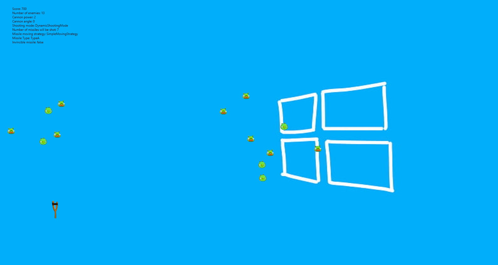

# NI - ADP semestrální práce

Course project focusing on trying out many different programming patterns. \
The attached code is the last version of the app but does not include code from most of the exercises done during the semester as each exercise focused on chaning the app in a different way.  

**Mouseclick** - to spawn enemies  
**Q** - to toggle background  
**T** - to toggle missile design  
**I** - to toggle missile invincibility  
**ô** - to do _something_ with the cannon

Add your own levels as a text file.

**New _patterns_**:
Adapter, Iterator, Builder, Prototype(model/gameoOjects/GameInfo)

## Game

